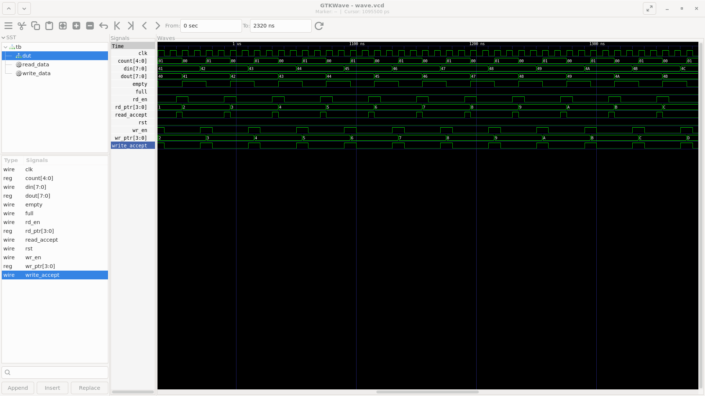
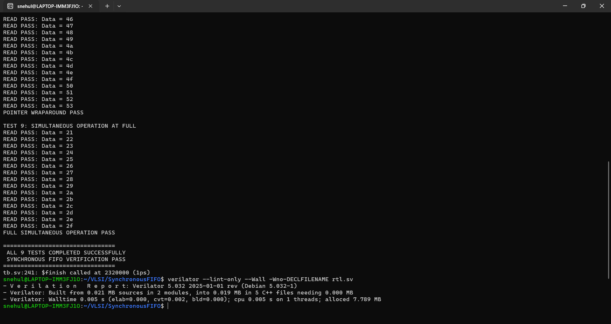

# Synchronous FIFO Design

A parameter-fixed, 8-bit × 16-entry Synchronous FIFO implemented using SystemVerilog. The design uses a single clock domain, circular read/write pointers, and occupancy-based status flags.

## Specifications

| Parameter | Value |
|---|---|
| Data Width | 8 bits |
| FIFO Depth | 16 entries |
| Address Width | 4 bits |
| Clock | Single synchronous clock |
| Reset | Synchronous, active-high |
| Read/Write | Independent enables |
| Status Flags | Full, Empty |
| Occupancy Counter | 5 bits |

## Architecture

The FIFO consists of:
- 16 × 8-bit memory array
- 4-bit write pointer
- 4-bit read pointer
- 5-bit occupancy counter
- Full and Empty status flags
- Read and write acceptance logic

### Operation

- **Write:** Stores input data at the current write pointer and advances the pointer.
- **Read:** Retrieves data from the current read pointer and advances the pointer.
- **Full:** Asserted when occupancy reaches 16.
- **Empty:** Asserted when occupancy is zero.
- **Pointer Wraparound:** Pointers automatically wrap around after reaching address 15.
- **Overflow Protection:** Write requests are rejected when the FIFO is full.
- **Underflow Protection:** Read requests are rejected when the FIFO is empty.

Simultaneous read/write operations are supported when the FIFO is partially occupied. At full, the read is accepted and the write is rejected. At empty, the write is accepted and the read is rejected.

## Verification

A self-checking SystemVerilog testbench was developed using Icarus Verilog.

### Test Scenarios

1. Reset and empty flag verification
2. FIFO filling and full flag verification
3. Overflow protection
4. FIFO ordering verification
5. Underflow protection
6. Simultaneous read/write operation
7. Reset during operation
8. Pointer wraparound
9. Simultaneous read/write operation when full

**Verification result: All 9 directed test scenarios passed.**

## Simulation Results

### GTKWave



### Simulation Terminal



## Tools Used

- SystemVerilog
- Icarus Verilog — RTL compilation and simulation
- GTKWave — waveform analysis
- Verilator — RTL linting

## Running the Simulation

Compile:

```bash
iverilog -g2012 -Wall -o sim/fifo.vvp rtl.sv tb.sv
```

Run:

```bash
vvp sim/fifo.vvp
```

View waveforms:

```bash
gtkwave sim/fifo.vcd
```

## Project Structure

```text
SynchronousFIFO/
├── rtl.sv
├── tb.sv
├── README.md
├── wave.png
├── terminal.png
└── sim/
```

---

**Project:** Digital Design & RTL Development  
**Focus:** Synchronous FIFO Architecture and Functional Verification