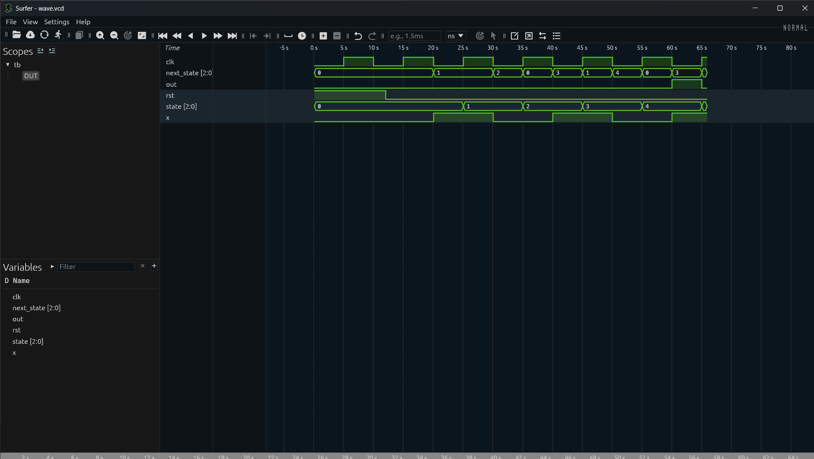

# 10101 Overlapping Sequence Detector — Moore FSM

## Overview
A 6-state Moore FSM implemented in SystemVerilog to detect the overlapping bit sequence `10101`.

## Features
- Overlapping sequence detection
- Dedicated detection state
- Asynchronous active-high reset
- Self-checking testbench
- Verified using Icarus Verilog
- Waveform inspection using Surfer

## Expected Input
`1010101`

Detects `10101` twice, including the overlapping occurrence.

## Simulation
```bash
iverilog -g2012 -Wall -o moore.vvp rtl.sv tb.sv
vvp moore.vvp
```
## Output
